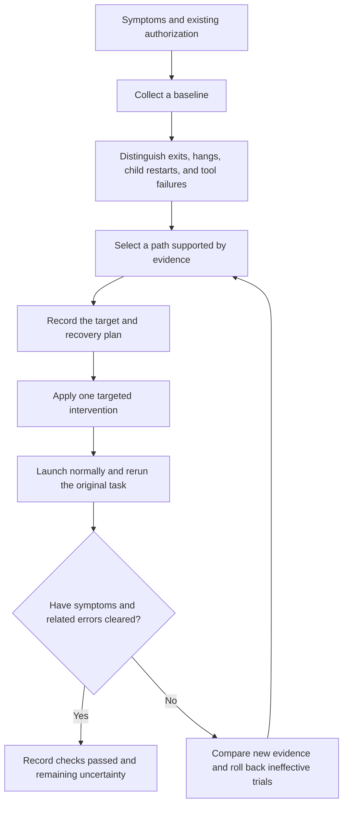

# fly-codexFix

**English** | [简体中文](README.zh-CN.md)

A Windows desktop troubleshooting and repair workflow for Codex. Provide your symptoms and repair authorization; Codex collects evidence, selects the relevant path, applies a targeted fix, and verifies the result.

**Version v0.2.0.** Eight diagnostic paths are available. Only runtime deployment has a real recovery case in this project. The other paths provide diagnostic methods and bounded repair guidance; their repair outcomes have not been validated across multiple devices.

## How to use

[Download the ZIP](https://github.com/flyl1u/fly-CodexFix/archive/refs/heads/main.zip) and extract it, or clone the repository in PowerShell:

```powershell
git clone https://github.com/flyl1u/fly-CodexFix.git
cd fly-CodexFix
```

Open the extracted project folder (or the cloned `fly-CodexFix` folder) in a local Codex environment with access to the affected Windows computer, then send:

> Read this project's AGENTS.md and use the codex-windows-repair workflow to diagnose and repair Codex crashes on this computer. Symptoms: [describe when it exits, how often it happens, and the most recent occurrence]. Collect evidence first, then apply the relevant repair. Preserve chats and project data, rerun the original task, and verify stability afterward.

You can also explicitly ask Codex to read `.agents/skills/codex-windows-repair/SKILL.md`. The skill's scripts and references are contained in that directory, so you can copy the skill folder separately. See the official OpenAI documentation for [skills](https://learn.chatgpt.com/docs/build-skills) and [AGENTS.md](https://learn.chatgpt.com/docs/agent-configuration/agents-md) for discovery details.

A Codex instance running remotely or on Linux needs actual tool access to the affected Windows computer to repair it. This repository does not grant additional host permissions.

## Codex workflow



Continue investigating when the evidence does not match a path. Do not run every repair in sequence. If an operation fails repeatedly without new evidence, change the diagnostic direction.

## Diagnostic paths and maturity

| Path | What to inspect | Status |
| --- | --- | --- |
| Runtime dependencies / AppX deployment | Frameworks, deployment events, system component health | Real recovery case available |
| App installation / updates | Current package state, files, distribution channel | Supported repair methods; awaiting cases |
| GPU / rendering | Main and GPU child processes, related errors | Diagnostic and comparison path; awaiting cases |
| Rendering cache / configuration | Active profile, cache errors, recovery results | Bounded isolation path; awaiting cases |
| Memory / disk / resources | Available memory, process usage, relevant volume space | Diagnostic path; awaiting cases |
| Plugins / integrations | Correlation between an individual integration and the failure | Isolation path; awaiting cases |
| Tools / permissions / network | Whether the main app is alive, actual execution environment | Distinguishes task failures from app crashes |
| Other native crashes | Exception codes, faulting modules, matching dumps | Investigation path; awaiting cases |

The [skill](.agents/skills/codex-windows-repair/SKILL.md) loads the relevant details as needed. See the [fault map](.agents/skills/codex-windows-repair/references/fault-map.md) for routing.

## Scripts and verification

The skill includes a diagnostic collector that outputs only allowlisted fields, a read-only stability observer, and a Windows component helper that decides whether to repair based on deployment evidence and actual component health. The repair helper supports `-WhatIf`. Project development and regression checks do not perform live system repairs on the current computer.

A passing observer result means only that process, responsiveness, and crash metadata checks passed during the specified window. Codex must also rerun the original task and check the relevant dependencies or errors. Without reproducing the original workload, verification is incomplete.

See the [validation record](docs/validation.md) for development checks and limitations, and the [test guide](tests/README.md) for repeatable previews and mock checks. These supporting documents are currently in Simplified Chinese.

To contribute cases, see the [contribution guide](CONTRIBUTING.md). The [historical case](docs/case-2026-10.md) documents the observed recovery. Both documents are currently in Simplified Chinese.

## License and affiliation

Original content is licensed under the [MIT License](LICENSE), with copyright attributed to `fly liu`. This is an independent community project, unaffiliated with OpenAI or Microsoft. It contains no product binaries, installers, application source code, private logs, or dumps.
