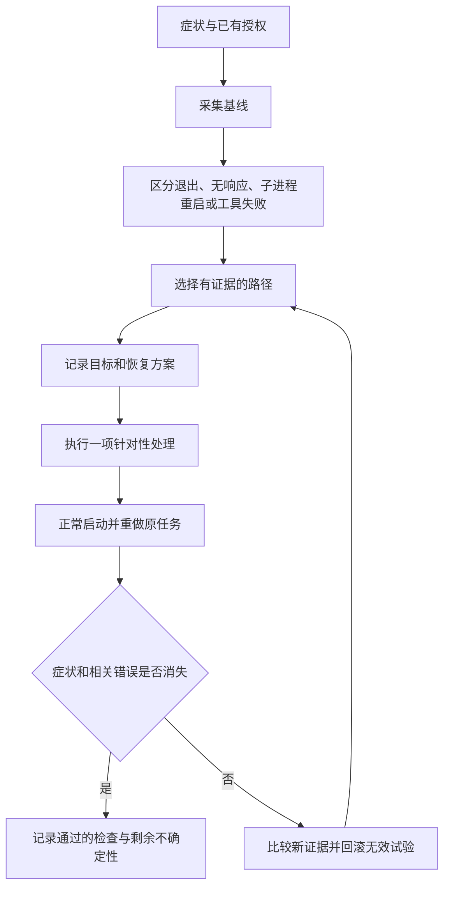

# fly-codexFix

[English](README.md) | **简体中文**

给 Codex 使用的 Windows 桌面故障诊断与修复工作流，你只需提供症状以及修复授权，Codex 将采集证据、选择适用路径、执行针对性处理并验收结果。

**v0.2.0 版本。** 已提供八类排查路径，只有运行依赖部署这一类有本项目的真实修复案例，其他路径提供诊断方法和受约束的处理建议，尚不代表在多台设备上验证过修复效果。

## 怎么使用

先[下载 ZIP](https://github.com/flyl1u/fly-CodexFix/archive/refs/heads/main.zip) 并解压，或在 PowerShell 中克隆：

```powershell
git clone https://github.com/flyl1u/fly-CodexFix.git
cd fly-CodexFix
```

在能访问故障 Windows 电脑的本地 Codex 中打开解压后的项目目录（或克隆得到的 `fly-CodexFix`），发送：

> 请阅读这个项目的 AGENTS.md，使用 codex-windows-repair 工作流诊断并修复这台电脑上的 Codex 闪退。症状是：［填写何时退出、多久出现、最近一次时间］。先采集证据，再执行适用的修复；保留聊天和项目数据，修复后重做原任务并验证稳定性。

也可以明确让 Codex 读取 `.agents/skills/codex-windows-repair/SKILL.md`。Skill 的脚本和参考资料在同一个目录中，可以单独复制这个 Skill 文件夹使用。发现方式见 [OpenAI 官方 Skill 文档](https://learn.chatgpt.com/docs/build-skills)、[AGENTS.md 文档](https://learn.chatgpt.com/docs/agent-configuration/agents-md)。

远端或 Linux 环境中的 Codex 无法凭仓库修复用户本机，需要实际 Windows 工具访问。仓库不会扩大宿主工具权限。

## Codex 的执行流程



没有匹配证据时继续调查，不能依次运行全部方案。相同操作失败且没有新证据时，应换诊断方向。

## 路径与成熟度

| 路径 | 重点检查 | 状态 |
| --- | --- | --- |
| 运行依赖 / AppX 部署 | 框架、部署事件、系统组件健康 | 有真实案例 |
| 应用安装 / 更新 | 当前包状态、文件、发布渠道 | 受支持处理方法，待案例 |
| GPU / 渲染 | 主进程与 GPU 子进程、相关错误 | 诊断与对照路径，待案例 |
| 渲染缓存 / 配置 | 活动 profile、缓存错误、恢复效果 | 有界隔离路径，待案例 |
| 内存 / 磁盘 / 资源 | 内存、进程占用、相关卷空间 | 诊断路径，待案例 |
| 插件 / 集成 | 单个集成与故障的相关性 | 隔离路径，待案例 |
| 工具 / 权限 / 网络 | 主程序是否仍活着、实际执行环境 | 任务失败与崩溃分流 |
| 其他原生崩溃 | 异常码、故障模块、匹配转储 | 定位路径，待案例 |

细节由 [Skill](.agents/skills/codex-windows-repair/SKILL.md) 按需加载，路由见 [故障目录](.agents/skills/codex-windows-repair/references/fault-map.md)。

## 脚本和验收

Skill 包含白名单诊断采集器、只读稳定性观察器，以及根据部署证据和实际健康状态决定是否修复的 Windows 组件处理器。修复助手支持 `-WhatIf`；项目开发和回归测试不在当前电脑执行系统修复。

观察器通过只代表指定时间内的进程、响应和崩溃元数据检查通过。Codex 还须确认原任务已重做，相关依赖或错误符合预期。没有复现原任务不能写成完整验收。

开发验证与限制见 [检查记录](docs/validation.md)；可复跑的预演/模拟检查见 [测试说明](tests/README.md)。

案例扩充见 [贡献说明](CONTRIBUTING.md)；历史案例见 [记录](docs/case-2026-10.md)。

## 许可与身份

原创内容采用 [MIT 许可](LICENSE)，版权署名为 `fly liu`。独立社区项目，不隶属于 OpenAI 或 Microsoft，不包含产品二进制、安装包、应用源码、私人日志或转储。
